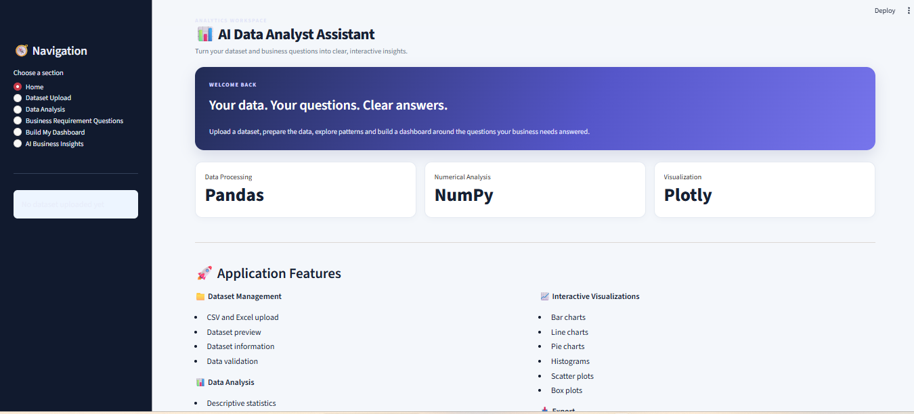

# 📊 AI Data Analyst Assistant
### AI-Powered Data Analysis, Dashboard & Business Insights Companion

AI Data Analyst Assistant is an AI-powered analytics platform designed to make data exploration, dashboard creation, and business reporting more accessible and interactive.

The application uses Artificial Intelligence to help users upload datasets, understand data quality, answer business questions through custom dashboards, and generate professional business insight reports.

## 🌐 Live Demo

**Try AI Data Analyst Assistant:**  
[Launch AI Data Analyst Assistant](https://aidataanalystassistant-2daebt3f4ecwbpi9hwcw4f.streamlit.app/)

## 📸 Application Screenshots

Explore the AI Data Analyst Assistant and its features through the screenshots below.

### 🏠 Home Page


### 📁 Dataset Upload & 🔍 Data Analysis


### 🧩 Custom Dashboard


### 🧠 AI Business Insights


## 🚀 Key Features

- **Dataset Upload** – Upload CSV or Excel files (`.csv`, `.xlsx`, `.xls`) and get an instant preview, overview, and column information.
- **Data Analysis** – Explore descriptive statistics, statistical measures, missing values, duplicate records, and correlations.
- **Data Cleaning** – Handle missing values (remove, mean, median, mode), remove duplicates, compare quality before and after, and download the cleaned CSV.
- **Business Requirement Questions** – Describe your business goal, questions, KPIs, comparison categories, time column, and preferred charts.
- **AI Dashboard Builder** – Gemini plans a dashboard from your requirements, and the app validates it against your real columns before rendering KPI cards and charts.
- **Interactive Visualizations** – Bar, line, pie, histogram, scatter, and box plots built with Plotly, with dashboard filters.
- **AI Business Insights** – Generate a structured report with Executive Summary, Key Observations, Potential Risks, Recommendations, and Conclusion.
- **Business Calculations** – Exact price, cost, and potential profit metrics calculated in Python, not guessed by the AI.
- **Category Analysis** – Compare product categories by average price, cost, and potential profit.
- **Export Options** – Download the AI report (`.txt`), cleaned dataset (`.csv`), and dashboard configuration (`.json`).

## 🛠️ Technologies Used

- Python
- Streamlit
- Pandas & NumPy
- Plotly
- Google Gemini AI (`google-genai`)
- scikit-learn
- openpyxl & xlrd
- python-dotenv
- Git & GitHub

## 📂 Project Structure

```text
AI_Data_Analyst_Assistant/
│
├── app.py
├── requirements.txt
├── .env.example
├── .gitignore
├── README.md
├── test_gemini.py
├── list_models.py
│
├── screenshots/
│   ├── home.png
│   ├── dataset-upload.png
│   ├── data-analysis.png
│   ├── dashboard.png
│   └── ai-insights.png
│
└── modules/
    ├── __init__.py
    ├── gemini_assistant.py
    ├── data_analyzer.py
    ├── data_cleaning.py
    ├── business_calculations.py
    ├── category_analysis.py
    └── dashboard_generator.py
```

| File | Purpose |
|---|---|
| `app.py` | Main Streamlit app with sidebar navigation and all pages |
| `gemini_assistant.py` | Gemini client, model fallback, and error handling |
| `data_analyzer.py` | Builds the dataset summary used in AI prompts |
| `data_cleaning.py` | Missing-value and duplicate handling |
| `business_calculations.py` | Product price, cost, and potential profit metrics |
| `category_analysis.py` | Category-level averages |
| `dashboard_generator.py` | Plans, validates, and renders the requirement-driven dashboard |
| `test_gemini.py` | Checks that your API key and model work |
| `list_models.py` | Lists Gemini models available to your key |

## ⚙️ Installation & Setup

### 1. Clone the Repository

```bash
git clone https://github.com/Sujitha0110/AI_Data_Analyst_Assistant.git
```

### 2. Navigate to the Project Folder

```bash
cd AI_Data_Analyst_Assistant
```

### 3. Create a Virtual Environment

```bash
python -m venv .venv
```

### 4. Activate the Virtual Environment

**Windows:**

```bash
.venv\Scripts\activate
```

**macOS / Linux:**

```bash
source .venv/bin/activate
```

### 5. Install Dependencies

```bash
pip install -r requirements.txt
```

### 6. Configure API Key

Get a free key from [Google AI Studio](https://aistudio.google.com/app/apikey), then create a `.env` file in the project root directory:

```env
GEMINI_API_KEY=your_api_key_here
```

Replace the placeholder with your Google Gemini API key. The app reads the key from Streamlit secrets (`.streamlit/secrets.toml`) first, then from `.env`.

**Security Note:** Never upload your `.env` file or API keys to GitHub.

### 7. Verify Your Setup (Optional)

```bash
python list_models.py
python test_gemini.py
```

If a model error appears, update the model names in `test_gemini.py` and in the `models` list inside `modules/gemini_assistant.py` using a name shown by `list_models.py`. The app tries each model in order and falls back to the next one if a call fails.

### 8. Run the Application

```bash
streamlit run app.py
```

The application will open in your browser.

## 📋 Dataset Requirements

Upload, data analysis, requirement questions, and the dashboard work with any CSV or Excel file. The business calculations and category analysis in AI Business Insights expect these columns:

| Column | Used for |
|---|---|
| `product_name` | Highest and lowest priced product |
| `product_category` | Category-wise analysis |
| `unit_cost` | Cost and potential profit |
| `target_price` | Price, potential profit, and margin |

Profit figures are labelled as **potential** profit (target price minus unit cost), not actual profit.

## 🧭 How to Use

1. **Dataset Upload** – Upload your CSV or Excel file.
2. **Data Analysis** – Check quality, statistics, missing values, duplicates, and correlations.
3. **Business Requirement Questions** – Describe your goal, questions, KPIs, and preferred charts.
4. **Build My Dashboard** – Generate a dashboard tailored to those requirements.
5. **AI Business Insights** – Generate and download a written business report.

## 🎯 Project Objectives

- Make data analysis easily accessible to non-technical users.
- Turn business questions into clear, interactive dashboards.
- Improve data quality awareness through cleaning and validation tools.
- Generate reliable AI insights grounded only in the uploaded data.
- Provide an interactive AI-powered analytics experience.

## ⚠️ Disclaimer

AI Data Analyst Assistant is an educational and portfolio project. AI-generated insights and recommendations may not always be accurate and should be verified before making business decisions. Profit figures shown are potential values based on the dataset, not confirmed actual profits.

## 🔮 Future Enhancements

- Support for databases and Google Sheets as data sources.
- Export dashboards as PDF or HTML.
- Save and reload analysis sessions.
- Additional chart types and advanced statistical analysis.
- Deployment on Streamlit Community Cloud.

## 👩‍💻 Developer

**Developed by:** Sujitha Vasudevan

**Project Name:** AI Data Analyst Assistant

**GitHub Repository:**  
[AI Data Analyst Assistant – GitHub](https://github.com/Sujitha0110/AI_Data_Analyst_Assistant)

**GitHub Profile:**  
[github.com/Sujitha0110](https://github.com/Sujitha0110)

**LinkedIn:**  
[linkedin.com/in/sujitha-vasudevan](https://linkedin.com/in/sujitha-vasudevan)

**Live Application:**  
[AI Data Analyst Assistant – Streamlit App](https://aidataanalystassistant-2daebt3f4ecwbpi9hwcw4f.streamlit.app/)

---

*Making data analysis smarter, faster, and more accessible through AI.*
